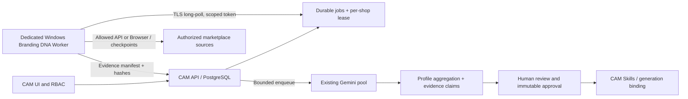

# Branding DNA — Dedicated Worker Architecture (pre-implementation ADR)

**Decision:** Build a dedicated **Branding DNA Scanner** process with its own Playwright runtime and browser profiles, hosted on a separate authorized Windows machine (or isolated Windows VM). **Reuse Scout Manager's deployment/monitoring patterns, not its Pinterest scraping code or Chrome profiles.** CAM VPS stays the central API, database, queue, Gemini and profile aggregator. No live scanner has been installed yet.

## 1. Evaluated options

| Approach | Advantages | Disadvantages / risks | Decision |
|---|---|---|---|
| A. More Chromium browsers on CAM VPS | One host, fast internal API | Competes with API, image workers, visual encoder, low disk headroom, operational blast radius | **Reject** |
| B. Add shop crawler as another mode in existing Pinterest Scout process | Some code reuse | Regression risk, mixed browser profiles, Pinterest backpressure and shared restarts | **Reject** |
| C. **Dedicated Branding DNA Windows worker**, managed as a separate card/process in CAM Scout Manager | Isolated process, existing experience with Windows Chrome profile lock, local repair, updater and telemetry | Separate agent, packaging, authenticated provisioning and health checks must be implemented | **Preferred** |
| D. Linux mini-PC / isolated VM dedicated to Playwright | Scalable per-container/service, works headless, no Windows licensing dependence | New runtime and support path; platform behavior and login management need verification | **Later alternate** |
| E. External hosted scraping-as-a-service | Low provisioning effort | Third-party data handling, fees, availability, policies, unpredictable platform access | Not default |

**Note:** The user's Windows Scout workspace can be offline/unavailable while CAM production is online. A dedicated machine must enroll and heartbeat independently. Do not co-schedule this workload on a workstation already running dozens of unrelated automation profiles without measured capacity approval.

## 2. Runtime responsibilities



**New package:** `apps/branding-dna-worker/` (planned; currently absent), using pinned Node LTS + Playwright Chromium. Separate lockfile, test fixtures and Windows release artifact. Use a shared `worker-management` protocol adapter only for heartbeat, version/update display and log transport. Never import Pinterest site selectors, queries or history.

**Machine baseline for pilot (planning assumption, not benchmark):** 4–8 physical CPU cores, 16 GiB RAM, SSD/NVMe with 30 GiB free *dedicated* to worker, reliable network. Prefer 32 GiB if concurrent browser jobs and gallery captures are planned. Start at **one browser context / one active shop / one listing navigation at a time** with memory/CPU ceilings. Increase toward 2–3 contexts only after 48-hour profiling; there is no promise of a fixed number of concurrent products based on RAM alone. Browser binaries, logs and captures must have disk quotas.

**Separation:** Worker Windows service or Manager child process runs under an unprivileged OS user; browser state under a dedicated `%LOCALAPPDATA%/CreativeAssetManager/BrandingDNA/profiles/<tenant>/<shop>/<platform>` data tree. Exclusive lock per profile; never point Playwright at the user's normal Chrome profile, Pinterest profiles or shared cookies. Separate temporary downloads, logs, structured JSON spool and process supervisor.

## 3. Control-plane and data-plane protocol

- **Registration:** Administrator enrolls machine with one-time short-lived code; server returns revocable agent identity + scoped credential stored in OS protected secret storage. Rotate and revoke independently of Scout Manager's Pinterest credentials.
- **Outbound-only:** Worker polls `/api/v1/branding-dna/agents/lease` over TLS (example **proposed**, not implemented); no open inbound machine port, no arbitrary remote desktop.
- **Lease:** Tenant-scoped `job_id`, `lease_id`, `attempt`, deadline, adapter version and allowlisted URL/scope. Time-limited lease with heartbeat renewals; expiration can requeue. Compare-and-swap claim and fencing token prevent late worker uploads from overwriting newer attempts.
- **Progress:** Append idempotent `event_id` and `listing_revision` events; worker local SQLite outbox persists unacknowledged payload manifests during CAM outages. Replay ACK removes outbox entries.
- **Credential boundary:** Worker never receives Gemini tokens, global CAM API secrets or credentials for other shops. Browser local storage/cookies remain local to the authorized shop profile; do not transmit in screenshots, logs or diagnostics.
- **Pause:** Stop claiming new listings; finish current safe transaction, persist cursor; Cancel requests best-effort termination without data loss. Hard kill is reserved for runaway browser process.
- **Kill switch:** Disable by tenant, shop, platform and agent; all new leases denied immediately and active sessions drained. Maintenance mode cannot keep a scan appearing as running without heartbeat.
- **Manual block handling:** `needs_operator` for CAPTCHA/login/rate limit restrictions; no challenge bypass, stealth plugins, proxy rotation to evade policy, automated login or headless detection evasion.
- **Idempotency:** `tenant_id + platform + canonical_shop_id + listing_id + variant_id + source_revision + task_type + model_version`; exactly-once **effects** through server idempotency, not claims that delivery never duplicates.

## 4. Source adapter strategy — API first, Browser as permitted fallback

| Platform/source | Primary | Browser fallback | Eligibility |
|---|---|---|---|
| Shopify **owned/authorized** | GraphQL Admin API cursor pagination and products/media; webhooks where authorized | UI only for presentation/visual layout not represented in API | Scoped app + token |
| Etsy **owned/authorized** | Etsy Open API v3 shop/listing/images using authorized key and OAuth scopes where needed | Public gallery UI if allowed | Respect API QPS/QPD, `retry-after` |
| Amazon **owned/authorized seller** | Amazon SP-API Listings Items and Catalog Items for suitable catalog/account data | Only allowed UI elements not in API | Seller authorization, marketplace selection |
| Other shops / competitors | Allowed public pages or authorized export/feed; manual URL collection if API lacks access | Restricted, policy-aware browser scan | Never assume full enumeration or seller API access |

Official reference links:
- [Playwright persistent profiles](https://playwright.dev/docs/api/class-browsertype)
- [Etsy authentication](https://developers.etsy.com/documentation/essentials/oauth2/)
- [Etsy rate limits](https://developers.etsy.com/documentation/essentials/rate-limits/)
- [Shopify GraphQL product pagination](https://shopify.dev/docs/api/usage/pagination-graphql)
- [Amazon SP-API listings lifecycle](https://developer-docs.amazon.com/sp-api/lang-en_EN/docs/manage-product-listings-guide)

Every adapter must declare: supported geography, shop identity discovery, capabilities (listing feed/gallery/variations/images), access mode, terms confirmation, robots policy applicability, pagination, known blind spots and `next_retry_at`. Do not label external shop scans **100%** without an independent authoritative inventory.

## 5. Suggested job contract

```json
{
  "job_type": "brand_listing_extract",
  "tenant_id": "tenant-id",
  "shop_id": "shop-id",
  "run_id": "run-id",
  "listing_key": "platform:shop:listing:variant",
  "source_url": "https://platform.example/allowed-listing",
  "source_revision": "etag-or-normalized-hash",
  "scope": ["metadata", "gallery"],
  "lease_id": "server-generated-opaque-value",
  "attempt": 1,
  "timeout_seconds": 120
}
```

This is an **illustrative contract**; the real server must generate lease and IDs, validate URL/redirect/DNS/IP against SSRF and canonicalize before dispatch. Never accept arbitrary user-supplied URL tasks on the worker.

Pipeline: `shop_validate -> enumerate_listing_keys -> extract_one_listing -> ingest_manifest -> image_analyze -> aggregate_candidate -> review_profile`. Source/image analysis queues are isolated by job type, backpressure from shared Gemini capacity and explicit bounded concurrency. No full-store hard loop in one job. Each cursor/manifest can resume after reboot.

## 6. Worker lifecycle and failure classification

States: `unregistered, idle, leasing, active, pausing, paused, needs_operator, retry_wait, unhealthy, updating, offline, disabled`. Per-task states: `pending, leased, running, completed, retry, permanently_inaccessible, blocked, cancelled`.

Failed parser / missing selector -> `parser_changed`, quarantine adapter with sample page evidence; `429` -> honor Retry-After and adaptive backoff; `403`/challenge -> stop requesting that source and surface operator action. Differentiate `shop_enumeration_incomplete` from `listing_extraction_failed`.

Health measures: heartbeat freshness (for liveness), **last successfully committed product** (for productive progress), last error, lease drift, queue age, output bytes, browser restarts, CPU/RAM, disk, credential expiry and adapter version. Heartbeat alone is insufficient to call a scan healthy.

## 7. Controlled rollout and promotion gates

1. **Contract/mock mode:** fake fixture shops, no external network, tenant/RBAC/auth tests, idempotency + crash/replay tests, UI states and Browser QA.
2. **One authorized Shopify or Etsy owned shop:** API adapter first; collect a baseline of known listing count for completeness verification. Operator must explicitly start pilot.
3. **One authorized Amazon seller:** use approved SP-API; when unavailable, declare scope limitation instead of claiming complete storefront access.
4. **Optional public storefront pilot:** only after platform-specific legal/policy and operational review; limited URLs, not unbounded enumeration.
5. **Scale:** memory/CPU/browser session budgets, queue fairness, stress test and worker update rollback proven for at least 48 hours.

### Do not install before Phase 2

Node/Playwright/browser on the dedicated Windows worker and optional platform API credentials are **future dependencies**, not prerequisites for UI/docs or `main` merge. No browser scanner was installed during this design review.
