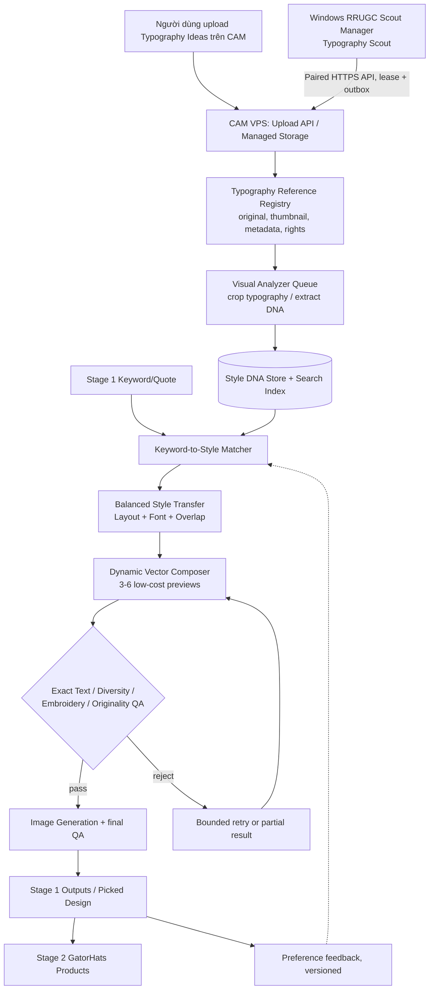

# CAM Typography Engine V2 — Implementation & Operations Runbook

> **Quyết định đã chốt:** xây hệ thống Typography Reference → Visual Analyzer → Style DNA → Balanced Transfer (Layout + Font + Overlap) → Dynamic Composer → Preview/Diversity QA → Image Generation → Stage 1 Output → Stage 2, đồng thời cho upload ảnh idea trên CAM và tự tìm reference bằng RRUGC Scout Manager trên Windows. Tái sử dụng hạ tầng có sẵn. Không thay thế ngay `concept-short-v1`.
>
> **Tình trạng tài liệu khi tạo:** kế hoạch được người dùng chấp thuận. Chưa có bằng chứng các hạng mục V2 đã được triển khai. **Không được đánh dấu tính năng hoàn tất, CI đạt hoặc production đã deploy chỉ từ tài liệu này.**

## 0. Cách sử dụng tài liệu khi người dùng chỉ gửi “tiếp tục”

Tài liệu này là **nguồn sự thật (source of truth) về kiến trúc và trình tự công việc**. `CAM_TYPOGRAPHY_ENGINE_V2_UI_BLUEPRINT.md` là **nguồn sự thật về UI/UX**; file HTML đính kèm là prototype để đối chiếu hình ảnh, không phải ứng dụng đã kết nối. `CAM_TYPOGRAPHY_ENGINE_V2_STATE.md` là **checkpoint tiến độ** và phải cập nhật cuối mỗi lượt làm việc.

Quy trình bắt buộc khi nhận tin nhắn **“tiếp tục”** trong ngữ cảnh tính năng này:

1. Mở **RUNBOOK + STATE + UI_BLUEPRINT**, ưu tiên `docs/operations/` trên checkout/repository CAM hiện hành; khi triển khai hoặc kiểm thử UI, mở thêm **HTML prototype**. Đọc `next_action` trong STATE rồi gate trong RUNBOOK, đối chiếu blueprint và prototype trước khi code. Nếu file chưa có trong repository, dùng bản đính kèm; **không phỏng đoán trạng thái đã hoàn tất**.
2. Đối chiếu với **trạng thái thật**: `origin/main`, worktree, PR/CI, migration, production, Windows agent. Không chỉ tin trường `done` do lần trước ghi.
3. Thực hiện **bước chưa hoàn tất đầu tiên có thể thực hiện an toàn**. Nếu nhiều bước liên quan liên tục và mọi điều kiện đều đạt, tiếp tục sang bước tiếp trong cùng lượt; không hỏi xác nhận lặp lại cho phạm vi đã phê duyệt.
4. **Dừng tại hard-block**, lỗi phân quyền, thiếu bằng chứng, test fail, nguồn Scout không được phép, migration/data safety không đạt hoặc lỗi production. Không bypass vì lý do muốn “xong nhanh”.
5. Kết thúc lượt: ghi bằng chứng, commit/PR/CI/deploy nếu đã đủ điều kiện; cập nhật STATE (thời gian, gate, kết quả, commit/PR, lệnh/test, blocker, rollback, `next_action`). Báo cáo ngắn cho người dùng: **đã làm, đã kiểm chứng, đang bị chặn ở đâu, bước kế tiếp**.
6. Mỗi tin nhắn “tiếp tục” là **một lượt thực thi mới**, không phải lệnh chạy âm thầm liên tục giữa các tin nhắn. Không hứa làm background hoặc tự thông báo vào thời điểm sau nếu không có automation thực sự.
7. Nếu ngữ cảnh mới không truy cập được repository, file hoặc máy tool, nói rõ giới hạn và chỉ xin lại quyền/file **khi thực sự không còn cách kiểm chứng khác**.

**Quy tắc tính tiến độ:** chỉ được chuyển `PENDING → IN_PROGRESS → VERIFIED` khi có bằng chứng tương ứng. `BLOCKED` luôn kèm lỗi cụ thể; `ROLLED_BACK` phải kèm trạng thái sau rollback. Không tự đặt các gate về VERIFIED dựa trên suy luận.

## 1. Phạm vi, mục tiêu, bất biến

### 1.1 Phạm vi bắt buộc

- Stage 1 **GatorHats Products — Keyword-to-Image** và đường nối Stage 2 đang có.
- Người dùng upload nhiều ảnh typography/ảnh mũ chứa embroidery typography lên **Typography Ideas Library** của CAM; quyền riêng tư theo tenant/workspace.
- RRUGC Scout Manager trên **máy Windows tool** mở rộng module **Typography Scout**: khám phá có kiểm soát, review candidate, dedup, đồng bộ qua API của CAM.
- VPS xử lý: visual analysis, crop/segmentation vùng typography, Style DNA, matching, balanced layout/font/overlap, SVG/preview, QA, image generation, lưu output.
- Bổ sung `concept-short-v2`, có feature flag và rollback về `concept-short-v1`.
- Chạy thử có kiểm chứng trên bộ ảnh reference đã cung cấp và bộ keyword đại diện; không tự động tái sinh tất cả keyword cũ.

### 1.2 Ngoài phạm vi giai đoạn đầu

- Không huấn luyện lại hoặc fine-tune model chỉ vì thêm reference.
- Không bắt Windows tool chạy GPU ImageGen/ComfyUI bắt buộc; VPS là nguồn dữ liệu và orchestration, provider AI tùy cấu hình sẵn có.
- Không thay thế Scout Review/Keyword/Cap Stack/Branding DNA, không đổi chính sách quyền các shop.
- Không tự truy cập tài khoản Pinterest/Behance/Etsy/Amazon bằng bypass CAPTCHA, anti-bot hoặc nguồn dữ liệu vi phạm điều khoản.
- Không đổi cấu hình Stage 2, đầu ra thêu, kho tồn, workflow duyệt manager hay stock khi chưa có nhiệm vụ độc lập và QA.

### 1.3 Bất biến cấp cao (hard requirements)

1. **Exact Keyword Lock:** nội dung chữ trong thiết kế phải đúng nguyên văn keyword/quote (từ, dấu câu, chữ hoa/thường, dấu tiếng Việt nếu có); được đổi line break/thứ bậc/đường cong, **không** thêm câu phụ, `EST.`, `Club`, `Since`, năm hoặc tên thương hiệu tự phát.
2. **Originality:** học nguyên tắc bố cục, đặc tính font và quan hệ overlap; **không** copy 1:1 hoặc truy vết quá sát chi tiết đặc trưng của một reference.
3. **Balanced mặc định:** giữ tinh thần thẩm mỹ nhưng thay đổi phối chữ, tỷ lệ, đường cong, vị trí glyph theo keyword mới; ưu tiên tính đọc được và thêu được.
4. **Safety by default:** một ảnh Scout chưa rõ quyền sử dụng chỉ là candidate; chưa được đưa vào nguồn generation chính thức trước gate về quyền truy cập/nguồn và kiểm duyệt cần thiết. Phân biệt `reference_for_analysis` với `licensed_to_reuse_asset`.
5. **No silent backfill:** không tự chạy lại 294 job/55k job, không tái tạo job hoàn thành, không gán job cũ sang V2 khi chưa được người dùng chọn.
6. **Protect live operations:** nguồn triển khai production phải là `main`, PR không merge khi CI đỏ; không phá `FOR UPDATE SKIP LOCKED`, fairness, policy/quota hoặc worker hiện hữu. Worker legacy tắt phải giữ tắt.
7. **Tenant isolation:** ảnh, embedding, Style DNA, kết quả search và quyền API không được chéo tenant. Không ghi secret/profile Chrome vào repo, log, PR, telemetry.
8. **No fake output:** không lấp đủ 6 slot bằng ảnh duplicate, render placeholder hoặc ảnh thiếu chữ. Hợp đồng output hiện tại có đoạn yêu cầu **đúng 6**; phải có phương án chuyển tiếp và test đầy đủ trước khi đổi.
9. **Windows D-only:** mọi file source, profile, cache, report, installer liên quan được cấu hình trên ổ D; không tự cài công cụ mới lên C. Không xóa profile/token hiện tại.

## 2. Kiến trúc đề xuất và vai trò hai máy



**VPS là source of truth**: chứa registry, audit, quyền, lease, pipeline và job. **Windows là nguồn candidate**: truy cập web khi hợp pháp, thu thập metadata/reference, gửi lên CAM và hiển thị trạng thái. Windows ngắt mạng => Stage 1 vẫn dùng Style DNA đã lưu; Auto Scout tạm dừng.

### 2.1 Các thành phần source có sẵn cần khảo sát trước khi sửa

Đường dẫn sau đã được phát hiện ở các lượt kiểm tra trước; **kiểm chứng lại trên `origin/main` tại Gate G0**:

| Thành phần | Đường dẫn / định danh quan sát được |
|---|---|
| Stage 1 job orchestration | `apps/api/app/modules/realistic_review_ugc/keyword_images.py` |
| Stage 1 renderer cũ | `apps/api/app/modules/realistic_review_ugc/stage1_typography_renderer.py` |
| Installed skills / Stage 2 registry | `apps/api/app/modules/realistic_review_ugc/stage2_skills.py`, `skill_registry.py` |
| Adapter Image Generation | `apps/api/app/providers/ai/codex_image.py` |
| Reference library | `apps/api/app/modules/realistic_review_ugc/reference_library.py` |
| Reference API | `apps/api/app/modules/realistic_review_ugc/router.py`, hiện có `/reference-assets` và `/reference-assets/uploads` |
| Models / repository | `apps/api/app/modules/realistic_review_ugc/model.py`, `repository.py` |
| Stage 1 UI | `apps/client/app/realistic-review-ugc/` |
| Windows Tauri manager | `apps/scout-manager-desktop/src/App.tsx`, `src-tauri/src/lib.rs` |
| Windows scout sources | `apps/rrugc_scout/`, scripts `START_SCOUT_KEYWORD.cmd`, `START_SCOUT_REVIEW.cmd`, `START_SCOUT_CAP_STACK.cmd` |
| Desktop startup / update | `START_SCOUT_TAURI.cmd`, `UPDATE_SCOUT_MANAGER_RELEASE.cmd` |
| Release scripts | `scripts/cam-rebuild-backend.sh`, `scripts/deploy-cam-frontend.sh` (kiểm tra đối số trước dùng) |

> **Điểm tương thích quan trọng:** `keyword_images.py` hiện có validator yêu cầu 6 final designs trong một số workflow và skill cũ `concept-short-v1`. Phải thiết kế contract V2 thể hiện số slot mong đợi, `valid_outputs`, `rejected_slots`, `partial`, retry; không tùy tiện nới validation global.

### 2.2 Hệ thống hiện diện (ảnh chụp thông tin, không phải cam kết phiên bản cuối)

- VPS: host alias `creativeasset`, repository `/srv/creative-asset-manager-source`, runtime `/opt/creative-asset-manager/current` và `/opt/creative-asset-manager/previous`.
- Windows: `DESKTOP-3FR0LF0`, workspace Tool thực tế kiểm tra được: `D:\Desify_Agentic\scan_pinterest`. Launcher nhận dạng `START_SCOUT_TAURI.cmd`, active-version marker tại `scout-manager-releases\RRUGC_Scout_Manager_Active_Version.txt`, đọc được `0.1.46` trong lượt kiểm tra 2026-10-28.
- Một số tài liệu cũ ghi `D:\Bot_Tool_Auto_Game\scan_pinterest`: **không tự chuyển thư mục**; dùng đường dẫn thực tế được xác minh trên máy tool.
- Checkout gốc VPS đã từng có nhiều file sửa/untracked. **Không thao tác git reset/clean/xóa ở checkout gốc** để bắt đầu dự án này. Chọn clean worktree từ `origin/main`.
- Các commit build từng ghi trong lịch sử có thể không còn mới. Không chốt SHA cứng trong script triển khai; trước mỗi lần triển khai xác minh `git rev-parse origin/main` và frontend `build-info.json` provenance.

## 3. Data contracts & database (đề xuất triển khai)

### 3.1 Reference asset

Tái sử dụng logic `RrugcReferenceLibrary` về ảnh, validation, hash/dedup, storage; mở rộng bằng profile `typography-idea`, **không** gán nhầm tham chiếu với profile realistic-person-ugc.

Dữ liệu tối thiểu:

```yaml
TypographyReference:
  id: uuid
  tenant_id: string
  workspace_id: string
  created_by: user_id|null
  original_asset_id: string
  thumbnail_asset_id: string|null
  sha256: string
  source_type: upload|scout|internal
  source_url: string|null
  source_platform: string|null
  source_rights_status: owned|licensed|permitted_reference|unknown|blocked
  source_attribution: string|null
  privacy: private|workspace
  scope: workspace|campaign|keyword|skill
  campaign_id: string|null
  keyword_id: string|null
  skill_name: string|null
  reference_roles: [layout, font_mood, overlap]
  influence: balanced
  preference: positive|negative|neutral
  priority: integer
  tags: [string]
  notes: string|null
  analysis_status: pending|running|ready|failed|needs_review
  editorial_status: candidate|approved|rejected|archived
  created_at: datetime
  updated_at: datetime
```

### 3.2 Style DNA (versioned)

```yaml
TypographyStyleDNA:
  id: uuid
  reference_id: uuid
  tenant_id: string
  schema_version: typography-dna/v1
  analyzer_version: string
  image_hash: string
  typography_region: {x: float, y: float, w: float, h: float} # normalized
  style_family: string
  font_mood: {primary: string, secondary: string|null, weight: string, contrast: string, proportions: string}
  layout_graph:
    nodes: [{id: string, role: primary|secondary, size_ratio: float, path_type: straight|arch|curve, align: string}]
    edges: [{from: string, to: string, relation: above|below|overlap|inside, strength: float}]
  overlap_rules: [{a: string, b: string, region: string, max_occlusion_ratio: float, reading_priority: string}]
  color_description: string|null # metadata only, không áp dụng trong pilot
  embroidery_risks: [string]
  distinctiveness_features: [string]
  perceptual_hash: string
  embedding_key: string|null
  confidence: float
  manual_override: object|null
  analyzed_at: datetime
```

Không lưu tọa độ tuyệt đối để copy nguyên template. `layout_graph` là **quan hệ tương đối**; cần chuyển thành các thông số thích ứng với độ dài và nét glyph keyword mới.

### 3.3 Generation lineage và feedback

```yaml
TypographyGenerationPlan:
  tenant_id: string
  keyword_job_id: string
  source_keyword_exact: string
  skill_name: concept-short-v2
  mode: balanced
  selected_components: [layout, font, overlap]
  selected_reference_ids: [uuid]
  selected_dna_versions: [{reference_id: uuid, analyzer_version: string}]
  plans: [{slot: int, layout_plan: object, font_plan: object, overlap_plan: object, preview_asset_id: string|null, qa_result: object}]
  valid_output_count: integer
  requested_output_count: integer
  status: queued|running|partial|completed|failed
  trace_id: string
  prompt_version: string
  model_version: string
  cost_breakdown: object
```

`PickedDesignFeedback` ghi ID output, style DNA version, người chọn, thời điểm và tín hiệu sở thích. Đặt mức ảnh hưởng có giới hạn để tránh feedback loop tạo nhiều thiết kế giống nhau.

### 3.4 Migration / quyền / lifecycle

- Alembic migration riêng, có kiểm tra schema hiện tại và kế hoạch rollback; không drop bảng cũ.
- Unique/indices đề xuất: `(tenant_id, sha256)`, `(tenant_id, editorial_status, analysis_status)`, `(tenant_id, scope, campaign_id, keyword_id)`, `(tenant_id, style_family)`; không truy vấn toàn bộ bảng mỗi keyword.
- Storage original/thumbnail có lifecycle riêng: chỉ xóa khi không còn reference, lineage/usage và không còn job phụ thuộc; log audit; bản preview tạm có TTL riêng.
- `tenant_id` phải nằm trong **mọi** query đọc/ghi, signed URL ngắn hạn và truy cập ảnh; không đưa URL public của ảnh private vào log.
- Phân quyền phân biệt `typography_reference.read/upload/manage`, `typography_generate.run`, `typography_scout.manage` và module navbar hiện hữu. Không coi quyền Viewer đương nhiên là quyền upload/xóa/đổi nguồn Scout.

## 4. API & event contract (đề xuất; chưa tồn tại)

Giữ tính nhất quán với router và policy hiện hành; tên endpoint dưới đây là **đề xuất**, agent phải kiểm tra API hiện có trước khi triển khai để tránh trùng.

| Method | Endpoint đề xuất | Mục đích / bảo vệ |
|---|---|---|
| `POST` | `/api/v1/realistic-review-ugc/typography/references/uploads` | Multipart nhiều ảnh, kiểm tra format/size/quota, dedup, trả status từng file |
| `GET` | `/api/v1/realistic-review-ugc/typography/references` | Phân trang, tìm tag/style/source/status, tenant-scoped |
| `GET` | `/api/v1/realistic-review-ugc/typography/references/{id}` | Detail, thumbnail, lineage, style DNA QA |
| `PATCH` | `/api/v1/realistic-review-ugc/typography/references/{id}` | Tags, scope, priority, positive/negative, review, archive |
| `POST` | `/api/v1/realistic-review-ugc/typography/references/{id}/analyze` | Idempotent enqueue khi hash/version chưa phân tích |
| `POST` | `/api/v1/realistic-review-ugc/typography/match` | Keyword + scope → candidate DNA có score & lý do |
| `POST` | `/api/v1/realistic-review-ugc/typography/previews` | Sinh preview SVG/PNG từ style plan, chưa gọi full ImageGen |
| `POST` | `/api/v1/realistic-review-ugc/typography/jobs` | Bắt đầu keyword V2 với idempotency key |
| `GET` | `/api/v1/realistic-review-ugc/typography/jobs/{id}` | Trạng thái từng slot, QA/retry/cost/source |
| `POST` | `/api/v1/realistic-review-ugc/typography/scout/leases/claim` | Paired agent chỉ claim job discovery được cấp |
| `POST` | `/api/v1/realistic-review-ugc/typography/scout/leases/{id}/complete` | Báo candidate, hash, source metadata, không tự approve |
| `POST` | `/api/v1/realistic-review-ugc/typography/scout/heartbeat` | Bounded heartbeat, last-error, version, backoff |

- Các request viết cần auth, RBAC và audit; retry có idempotency; response lỗi có `code`, `retryable`, `trace_id`, `message` ngắn gọn.
- Sử dụng token pairing riêng/scoped với công việc Typography Scout. Không dùng lại token tổng quyền khi không cần. Không log bearer token/cookies.
- Phản hồi job chứa `partial` rõ ràng. Không gắn completed khi slot chưa qua QA.

## 5. Balanced Style Transfer — thiết kế logic

### 5.1 Phân tích input exact text

- Lưu `source_keyword_exact` từ Stage 1, không trim/normalize rồi ghi đè bản gốc. Bản phân tích có thể dùng normal form riêng chỉ để matching; renderer phải tạo đúng text gốc.
- Lập `text_segments` theo từ/cụm và dấu câu, đo bounding box sau khi chọn font, xác định các từ khóa chính/nhịp chữ nhưng **không đổi thứ tự**.
- Không tự thêm ký tự `EST`, `2026`, dấu ngắt hoặc icon thay chữ. Có thể giữ dấu câu đi cùng từ.

### 5.2 Trích Layout + Font + Overlap

- **Layout:** số lớp, hướng cơ bản, arch/straight, hierarchy, alignment, width distribution, vertical rhythm; chuyển thành graph để linh hoạt với keyword dài/ngắn.
- **Font:** xác định đặc tính hình dáng (serif, high contrast, sport block, script, casual) thay vì cố tìm/copy chính xác font thương mại. Chọn font từ allowlist đã cấp phép và lưu provenance font. Renderer nâng cấp kerning, width scale có giới hạn, tracking, baseline, biến dạng vector nếu cần.
- **Overlap:** vùng giao thoa có kiểm soát giữa primary và script; bảo vệ dấu, các nét quan trọng, không che làm đổi chữ; không giả định mọi keyword đều phù hợp script overlap.

### 5.3 Matching & Diversity

Một lệnh generate chạy:

1. Lấy ảnh đã duyệt theo scope keyword > campaign > workspace, ưu tiên user-upload; bổ sung Scout approved để khám phá.
2. Tạo pool đề xuất (ví dụ 18–24 reference/DNA đã index), loại duplicate hash/pHash và mẫu có originality/rights gate không đạt.
3. Chấm mức phù hợp theo text length, readibility, letter shape, font availability, embroidery budget, preference; **không** hard-code một font hoặc template cho cả sáu slot.
4. Lấy 2–4 DNA mang tính **bổ sung** cho mỗi style plan khi phù hợp. Không sao chép toàn bộ composition của một ảnh.
5. Chọn 3–6 hướng đa dạng theo layout graph + font family + overlap topology, có seed/trace để tái hiện. Độ đa dạng có thể ưu tiên 4 nhóm khác nhau khi sinh đủ 6.
6. Dựng preview (SVG trước, PNG để review), QA, rồi mới gửi các slot hợp lệ vào Image Generation.

**Balanced policy mặc định đề xuất** (có thể sửa sau pilot): các thành phần Layout/Font/Overlap đều bật; không dùng trực tiếp color palette/product styling; source preference `user_upload > curated_internal > approved_scout`; giới hạn overlap theo chữ thực tế; độ ảnh hưởng của một reference không được chi phối toàn bộ sáu concept. Đây là **chính sách đề xuất**, không phải hằng số đã được áp dụng.

### 5.4 Renderer / embroidery

- Dựng vector/SVG layer: text shape, path, transformation, stroke/occlusion masks; renderer deterministic và phát sinh source graph kèm output, phục vụ QA và debug.
- Font allowlist kiểm tra license, pin phiên bản/checksum; không phụ thuộc Dafont hoặc font tự nhận dạng từ ảnh reference.
- Validate stroke min, negative-space min, số màu chỉ, khả năng tách đường thêu, kích thước vùng embroidery thực tế theo product profile; threshold theo cấu hình, không đoán một giá trị mm cho mọi mũ.
- Output Stage 1 phải còn đúng format/canvas/transparent background và vị trí design mà Stage 2 hiện đang tiếp nhận; **không** regenerate cả mũ tại Stage 1.
- QA exact text theo **vector/source text contract** trước; thị giác/OCR là kiểm tra phụ trong pilot khi cần, không lấy OCR làm bằng chứng duy nhất cho chính tả.
- Originality guard nhận diện quá giống một mẫu ở tổng thể quan hệ, không chỉ ảnh pixel; flag để đổi composition, không âm thầm copy.

### 5.5 Contract sáu slot hiện hữu

- V1 giữ nguyên hành vi `exactly six` và không sửa logic V1.
- V2 khai báo `requested_slots=6`, `eligible_slots`, `failed_slots`, `partial` và `actual_count`, không fake design.
- UI/DB/API/export/Stage 2 phải được chỉnh và test hỗ trợ trường hợp `<6` trước khi bật V2 trong production. Nếu contract downstream chưa hỗ trợ, V2 **chưa bật**; tuyệt đối không đổi dấu completed giả.

## 6. Windows Tool — setup và vận hành

**Đích:** nâng cấp app RRUGC Scout Manager đang có, **không cài thêm app thứ hai**. Đường dẫn thực tế đã quan sát: `D:\Desify_Agentic\scan_pinterest`; release đánh dấu `0.1.46` vào 2026-10-28. Xác minh lại version, source & active path trong G0.

### 6.1 UI thêm một card/section `Typography Scout`

- `Discover` / `Pause` / `Resume`, trạng thái `Waiting`, `Running`, `Blocked`, `Offline`, `Error`.
- Counter: pending discovery, candidate, uploaded, duplicate, rejected, needs-rights-review, last sync, last successful heartbeat.
- Thông tin `Source / Search / Batch / Lease / Retry`, `View Logs`, `Open CAM Typography Library`.
- Chrome minimize toggle tương thích chức năng chung: minimize cửa sổ browser nhưng browser process/session và lease **vẫn chạy**, không được hiểu là pause. Test hành vi này trên Windows thật.
- Giới hạn request/giờ, lịch chạy, khoảng nghỉ và source allowlist có thể cấu hình nhưng không được vượt chính sách nguồn.

### 6.2 Windows worker / outbox

1. Agent nhận lease từ CAM; CAM tạo task only khi Auto Scout enabled và nguồn được phép.
2. Query/visit nguồn theo cơ chế được phép (API hoặc URL/board public có quyền); ghi attribution + URL + timestamp + hash + policy signal.
3. Dedup ở máy tool trước khi upload; giới hạn kích thước/tốc độ; gửi candidate qua HTTPS với idempotency key; CAM dedup lần hai.
4. Nếu offline/reboot/browser mất kết nối: lưu checkpoint vào SQLite/outbox trên D; restart thì resume từ lease id, không gửi trùng.
5. Nếu gặp challenge/auth failure/rate limit/403: ghi `blocked` và backoff, **không** bypass hoặc chạy browser stealth.
6. Dừng/đổi profile Chrome không làm mất session của Review/Keyword/Cap Stack/Branding DNA; mỗi nguồn dùng profile riêng nếu hợp lệ.
7. Credential chỉ ở Windows local config/secure store; không in env/token vào log hay tài liệu. Không di chuyển tệp profile vào repo/PR.

### 6.3 Quy trình release Windows

- Build Tauri/Windows runner từ tag/main đã đạt CI, ký/hash artifacts theo quy trình hiện tại.
- Dùng `UPDATE_SCOUT_MANAGER_RELEASE.cmd` tải bản checksum-verified; lưu bản previous để rollback.
- Dùng `START_SCOUT_TAURI.cmd` khởi động, xác minh source/version hiển thị và heartbeat CAM.
- Test bật/tắt auto-scout, minimize/restore Chrome, restart Windows, ngắt mạng/khôi phục; không ảnh hưởng các Scout cũ.
- **Không cài sản phẩm lên C và không xóa dữ liệu người dùng** để chữa lỗi cài đặt.

## 7. UI CAM Web — thiết kế chức năng

**Chỉ thêm vào Stage 1**, không làm Stage 2 biến thành reference library.

### 7.1 Library

- Entry point `Typography Ideas` ở Stage 1, modal/drawer tối ưu responsive.
- Batch upload drag/drop, progress từng ảnh, preview thumbnail, size/type error, duplicate detection.
- Grid/masonry có tìm kiếm, filter: `source_type`, style family, tags, `approved/pending/archived`, `positive/negative`, campaign/keyword/skill.
- Detail một reference: ảnh, vùng chữ được crop, notes, `Layout`, `Font mood`, `Overlap`, quyền/attribution, lần phân tích, confidence, nút `Re-analyze` có kiểm soát.
- Quyền cấp theo tenant/module; viewer thông thường chỉ thấy phần có read permission; không mở upload/manage trái phép.

### 7.2 Apply Reference Style

- Chọn 1–6 reference manual hoặc `Auto match from library`.
- `Mode: Balanced` mặc định; 3 checkbox `Layout`, `Font`, `Overlap` bật mặc định. Không tự lấy màu, họa tiết vành mũ, lighting/product styling cho Stage 1.
- `Preview concepts` không gọi full ImageGen; hiện 3–6 concept, hướng Style DNA/source attribution và lỗi QA.
- `Generate` chỉ gửi những preview hợp lệ. Hỗ trợ single row re-run và retry failed slot, giữ nguyên completed outputs.
- `Picked Design` gửi feedback versioned, không thay nội dung keyword hay đổi những design đã pick.

### 7.3 UI/UX Blueprint V1 — design đã chuẩn bị trước cho lúc setup

**BẮT BUỘC đọc:** [`CAM_TYPOGRAPHY_ENGINE_V2_UI_BLUEPRINT.md`](CAM_TYPOGRAPHY_ENGINE_V2_UI_BLUEPRINT.md), cùng bản xem trước [`prototypes/CAM_TYPOGRAPHY_ENGINE_V2_UI_PREVIEW.html`](prototypes/CAM_TYPOGRAPHY_ENGINE_V2_UI_PREVIEW.html). Thiết kế được xây dựng để **thi công theo đúng mẫu**, không còn phải tự chọn vị trí button, drawer, panel, trạng thái hoặc bố cục.

**Các vùng UI đích:**

1. `Stage 1 > Keyword Jobs` (mặc định): giữ nguyên stepper Stage 0–3, KPI/search/sort/table/output/picked design và toàn bộ V1; thêm subtab trong Stage 1 + nút `Apply style` trong Actions từng row, không thêm cột cồng kềnh.
2. `Stage 1 > Typography Ideas`: upload nhiều ảnh, status theo ảnh, masonry grid, filters/search, detail drawer với crop/DNA/rights/usage, approve/soft archive theo RBAC.
3. `Stage 1 > Style Lab`: **References (trái) + Concept Previews (giữa) + Balanced Controls (phải)** trên desktop; responsive 2 vùng ở tablet, một cột trên mobile. `Layout + Font + Overlap` mặc định bật, source keyword exact, preview low-cost trước ImageGen; `Generate eligible` phải có confirm/budget và status từng slot.
4. RRUGC Scout Manager Windows: thêm **Typography Scout card** vào tool Tauri hiện hành, giữ Review/Keyword/Cap Stack/Branding DNA, giữ nút Run/Pause/Chrome minimize; Auto Scout OFF trước gate. Màn hình tool là **ứng dụng Windows riêng** — nút `Windows Tool mock` trong HTML chỉ để xem demo và **không** được triển khai thành subtab trên CAM Web.

**Thông số và behavior đã chốt:** tokens, 1440/768/390 breakpoints, drawer 560px, Style Lab 3-column, reference card và upload states, scoped permission, no-auto-mutating, responsive/modal z-index, empty/loading/errors, feature flags, partial 3–6 output và UX-01..UX-16 đều ở UI_BLUEPRINT §2–§11.

**UI freeze policy:** mặc định phải implement đúng UI_BLUEPRINT; nếu structure source hiện tại có xung đột, trước khi đổi design phải ghi lại tương thích và bằng chứng trong PR/STATE. Không thay đổi Stage 2 hoặc global navbar vì tính năng này. Prototype chỉ mô phỏng data/control, **không kết nối API, không thực hiện generation hoặc upload thật**.

**Gates ràng buộc UI:** G0.0 đưa 3 file `.md` và một file `.html` (đúng path) vào repo; G2 Library & Stage 1 subnav; G4 Style Lab; G6 liên kết action và trạng thái job; G7 Windows Scout; G8 browser QA **UX-01..UX-16** và screenshot compare; G10 production authenticated smoke. Không được đánh dấu các gate này VERIFIED chỉ vì prototype HTML chạy.

## 8. Công việc theo gates — có thứ tự, điều kiện vào/ra, bằng chứng

**Mỗi gate chỉ VERIFIED khi đã đạt toàn bộ acceptance và đã cập nhật STATE.** Có thể mở nhiều PR nhỏ, nhưng **không merge khi CI chưa đạt**.

### G0.0 — Persist all documentation and UI design into CAM repository (first continuation)

If not already present in `origin/main`, put **four artifacts** into a clean docs-only worktree preserving UTF-8:

- `docs/operations/CAM_TYPOGRAPHY_ENGINE_V2_RUNBOOK.md` (this file)
- `docs/operations/CAM_TYPOGRAPHY_ENGINE_V2_STATE.md`
- `docs/operations/CAM_TYPOGRAPHY_ENGINE_V2_UI_BLUEPRINT.md`
- `docs/operations/prototypes/CAM_TYPOGRAPHY_ENGINE_V2_UI_PREVIEW.html`

Open a **documentation/prototype-only PR**, run full required CI, merge into `main` only when all gates pass; do **not** commit any private reference images, user screenshots/data, Chrome profiles or tokens. If repository access is unavailable, retain all four downloadable artifacts and mark `BLOCKED: checkpoint_not_persisted`. This gate **does not change production services, feature flags, Scout or job queues**.

**Exit:** all four files can be read from `main` at their documented paths; UI blueprint and HTML prototype match, with docs PR SHA/CI evidence recorded. Then G0.1.

### G0 — Baseline & safety preflight (bắt buộc đầu tiên)

**Thực hiện:**
- Xác minh `origin/main`, release current/previous, worktree sạch phù hợp, git status từng máy; **không đụng checkout gốc đang dirty**. Tạo clean worktree từ `origin/main` với branch `feat/cam-typography-v2-*` cho từng PR.
- Ghi kiểm kê chính xác mã nguồn các chức năng hiện hành nêu ở §2; đặc biệt API, models, job claims/worker, Skill manifest và frontend dist provenance.
- Kiểm tra VPS CPU, disk, RAM, số processing_jobs theo status, Elasticsearch, PostgreSQL, object storage và backup; xuất baseline metric vào tài liệu evidence (không chứa dữ liệu nhạy cảm).
- Kiểm tra máy Windows D path, Scout Manager active release, Chrome/profile, agent pairing, token hợp lệ mà không đọc hoặc in token.
- Chốt `feature flags` mặc định `false`; chốt cách rollback và health endpoints.

**Gate pass:** không có rủi ro gây mất source/dữ liệu chưa giải quyết; đã xác nhận path, chủ sở hữu workspace, contract 6-slot và rollback baseline. **Bằng chứng:** SHA baseline main, service health, worker list, disk report, tool version. `next_action=G1.1`.

### G1 — Contract / schema / API nền tảng (VPS)

**Thực hiện:** model + migrations additive, tenancy/RBAC, file registry profile mới, reference uploads/lists/detail/update/delete-soft, tagging, rights/status, batch response, API tests, lineage.

**Gate pass:** upload đúng tenant, dedup, không leak cross-tenant, size/formats theo limit (hiện `RrugcReferenceLibrary` có 20 MB và validate image), rollback schema thực tế; không sửa UGC dữ liệu cũ. **Bằng chứng:** migration check PostgreSQL, API tests, test negative auth.

### G2 — Web UI Typography Ideas Library

**Thực hiện:** theo `UI_BLUEPRINT` §§2–3: Stage 1 subnav giữ Keyword Jobs mặc định, Typography Ideas full library, upload/masonry/search/filter/detail/permissions/empty/loading/error, reference status, rights + DNA drawer, test responsive. Không tự tạo Windows tab trong CAM Web.

**Gate pass:** có thể upload 8 ảnh mẫu (với quyền sử dụng được xác minh), thấy trạng thái riêng từng ảnh; duplicate không tạo file thứ hai; không nổ layout mobile; UI không tự gửi tác vụ AI khi chưa yêu cầu; đối chiếu screenshot UX-01..UX-04 và UX-08, UX-13..UX-14. **Bằng chứng:** screenshots desktop 1440/tablet 768/mobile 390, unit/e2e tests và UI diff so với prototype.

### G3 — Visual Analyzer + DNA versioning

**Thực hiện:** queue riêng và bounded workers (bắt đầu 1–2 concurrency); crop vùng chữ, font/layout/overlap analyzer; schema validation; cache theo `image_hash + analyzer_version`; manual override, retry/budget, duplicate perceptual hash.

**Gate pass:** có Style DNA có thể đọc được cho các ảnh pilot; không trộn product/background với typography; ảnh lỗi có `failed/needs_review`, không lặp AI phân tích file cũ vô hạn. **Bằng chứng:** 8 mẫu DNA sanitized, logs latency/cost, test cache hit.

### G4 — Reference matching + Dynamic Composer

**Thực hiện:** selector versioned; filter rights/source/tenant, match theo keyword; bộ SVG/vector layout/font/overlap deterministic; `font allowlist` licensed/pinned; 3–6 low-cost previews. Tạo `Style Lab` 3 vùng theo `UI_BLUEPRINT` §4, Balanced mode và Layout/Font/Overlap checked; G4 UI smoke UX-05..UX-07.

**Gate pass:** từ cùng một reference áp lên ít nhất 3 keyword độ dài khác nhau mà **không thay quote**; không copy nguyên thiết kế; preview khác biệt rõ về graph, không chỉ màu. **Bằng chứng:** 20-keyword pilot preview sample và QA report.

### G5 — Exact text / originality / diversity / embroidery QA

**Thực hiện:** QA source-text layer, normalized compare chỉ cho validation, glyph visibility, overlap occlusion, vector minimums; structural similarity score; retry budget; partial statuses.

**Gate pass:** các output được đánh dấu eligible đều đúng keyword; fail QA không chuyển `completed`; 3–6 output tương thích UX/API; có lý do reject rõ, không filler. **Bằng chứng:** tests keyword dài/ngắn, dấu câu, Unicode, script overlap, dedup, partial output.

### G6 — Stage 1 V2 job integration / Skill runtime

**Thực hiện:** tạo & kiểm chứng `concept-short-v2`; tích hợp selector/preview vào Stage 1; Job payload có skill/dna/prompt_version/trace; enforce policy/quota; preserve existing SKIP LOCKED/fairness; output artifacts Stage 2-compatible; no automatic mass rerun.

**Gate pass:** cài/enable V2 riêng cho pilot tenant/campaign; V1 vẫn chạy như trước; end-to-end Stage 1 → picked design → Stage 2 dùng được; không đụng dữ liệu cũ. **Bằng chứng:** provider/job integration tests, QA artifacts & regression.

### G7 — Windows Typography Scout extension

**Thực hiện:** thêm `TypographyScoutCard` đúng `UI_BLUEPRINT` §5 vào RRUGC Scout Manager, scoped paired endpoints lease/heartbeat/outbox, source allowlist/rights gate; Windows installer/portable update + smoke thực tế. Bảo toàn Run/Pause/minimize và các module hiện có; UI screenshot UX-11/UX-12.

**Gate pass:** tool Windows vNext chạy độc lập khỏi Review/Keyword/Cap Stack/Branding DNA, pause/minimize không stop job ngoài ý muốn; reboot/offline recover không duplicate; challenge block không bypass. **Bằng chứng:** Windows Tauri UI screenshots, agent heartbeat, integration tests, SHA release. Auto Scout **OFF** cho đến G9 pilot đạt.

### G8 — Performance, security, Browser QA, operations

**Thực hiện:** test load upload batch/analysis, tenant scope, storage growth & TTL, concurrency/quota/backoff, API security, full frontend QA, use-case regression, cleanup only with evidence; dashboards/counters/alerts. Thực thi đầy đủ `UX-01..UX-16` theo `UI_BLUEPRINT` §9, so sánh screenshots thật với prototype và ghi lại intentional differences.

**Gate pass:** không CPU pin kéo dài do query/worker mới, không scan full backlog, không mất file chưa được xác nhận, không rò token/tenant; tất cả CI & Browser QA đạt. **Bằng chứng:** execution/buffer timing, disk before/after, queue metrics, logs/screenshot.

### G9 — Pilot A/B + manual approval

**Thực hiện:** chọn 8 reference user cung cấp + 20 keyword đại diện (dài/ngắn, script, punctuation), so sánh V1/V2; kiểm tra quyền sử dụng từng reference và độ giống, quan sát cost, sự ổn định; đánh giá design chọn được.

**Gate pass tối thiểu:**
- **100%** output được chấp nhận giữ đúng keyword.
- Khi xuất đủ 6 phương án, mục tiêu **≥4 nhóm bố cục khác nhau** với độ đọc/thêu đạt; không đạt điều kiện thì báo partial thay vì bổ sung ảnh giả.
- Không tạo lại bất kỳ job cũ nào ngoài danh sách pilot được chỉ định.
- Không ảnh hưởng Scout hiện hữu/Stage 2/tenant khác.
- Có báo cáo chi phí và số lần retry, p95 latency, QA rejection theo nguyên nhân; không vượt ngân sách pilot đã chốt trong cấu hình.
- Quyết định kích hoạt chỉ sau **đủ bằng chứng**; nếu chưa đạt thì trở lại G4/G5 sửa.

### G10 — Merge main, deploy production, activate có kiểm soát

**Điều kiện vào:** G0–G9 VERIFIED; PR đã đạt toàn bộ CI; có rollback tested; source main mới bao gồm backend/frontend/Windows commit phù hợp.

**Thứ tự:**
1. Merge PR vào `main` theo CI, không force push, không bypass protection.
2. Deploy additive migration/backend từ **main** qua script hiện hành, giữ `current` + `previous`; health check API/worker/DB/ES; rollback nếu lỗi.
3. Deploy frontend dist theo đúng commit source provenance; smoke authenticated Stage 1/Library/preview/Stage 2, tablet/mobile; rollback frontend nếu lỗi.
4. Build/release Windows tool từ main; checksum-verify, cài/refresh vào D, kiểm tra version/heartbeat; giữ binary previous.
5. Bật feature flag pilot theo tenant, theo dõi canary, sau đó mới bật rộng. Auto Scout chỉ bật sau rights/permission/ToS gate.
6. Kiểm chứng production sau deploy qua public `/version`, `/build-info.json`, `/ready` và luồng người dùng thật (không write stock).

**Gate pass:** full regression, source SHA/API/frontend/Windows version đều có evidence, 0 lỗi critical, rollback luôn sẵn sàng. Nếu gate fail, dừng rollout và rollback đúng thành phần; không khẳng định “deploy thành công” khi mới có backend mà chưa có frontend/tool.

### G11 — Handover & operations

**Thực hiện:** tài liệu SOP, version matrix, troubleshooting, dashboard alarms, backup/lifecycle, operator training, QA evidence sanitized, cập nhật STATE sang `DONE` sau khi đã nghiệm thu production.

**Gate pass:** operator có thể upload/approve references, bật/tắt Scout, chạy V2, retry hỏng và rollback mà không cần sửa code; tài liệu phản ánh đúng trạng thái production.

## 9. Test matrix tối thiểu

| Nhóm | Test phải có |
|---|---|
| API auth | Tenant A không đọc/sửa/thấy thumbnail tenant B; Viewer không được upload/approve nếu thiếu quyền |
| Upload | 0B, >20MB, corrupt, MIME spoof, HEIC, duplicate, batch partial, upload interrupted |
| DNA | Cache hit/miss đúng version, crop sai, no-text, multi-cap composite, analyzer timeout/budget |
| Keyword | Exact upper/lower, Unicode, punctuation, line-break, multiple words, length extremes |
| Layout | Arch/straight/stack/multi-level, responsive bounding box, flow không che dấu |
| Font | OFL/license, missing font, pin checksum, fallback có ghi provenance, font cache |
| Overlap | Script x serif, occlusion quá mức, readability, không mất chữ, không tự thêm từ |
| Diversity | 6 output không chỉ đổi font/màu, tránh duplicate pHash/graph, partial output có trạng thái đúng |
| Pipeline | Retry đúng failed slots, preserved completed, job idempotency, policy fairness/SKIP LOCKED, không tự rerun |
| Stage 2 | Original/canvas/alpha/asset IDs đúng; picked design không bị đổi; không regenerate whole cap |
| Windows | Restart, offline sync, lease expiry, double claim, token revoked, Chrome minimize vs pause, outbox dedup |
| Sources | Attribution, allowed list, ToS, blocked source, no bypass, content rights state |
| UX | Desktop/tablet/mobile modal/scroller, navbar RBAC, loading/error/retry, keyboard access |
| Release | PR CI green, frontend provenance, migration, API+worker ready, tool SHA, rollback smoke |

## 10. Quan sát, bảo trì và dừng khẩn cấp

### 10.1 Telemetry cần triển khai

- Per-stage: `references_uploaded/duplicated/rejected`, `analysis_pending/running/failed`, `analysis_cache_hit`, `style_family_distribution`, `keyword_match_duration`, `preview_success/partial`, `qa_rejected_by_reason`, `generated_output_count`, `picked_rate`.
- Resource: CPU/RAM VPS, PostgreSQL query execution/shared/temp buffers, queue claim/backoff, storage bytes + TTL backlog, external AI calls, timeouts và chi phí/token/image.
- Windows: agent version, last heartbeat, scan jobs claimed/completed, blocked by rights/rate-limit, outbox depth, Chrome minimize state, retry count.
- Alert khi backlog không tiến triển, CPU kéo dài cao, ảnh/thumbnail không nhất quán hoặc log/preview tăng dung lượng bất thường.

### 10.2 Kill switches

- `TYPOGRAPHY_V2_ENABLED=false` (không dispatch job V2 mới; job đang chạy xử lý theo state an toàn đã xác định).
- `TYPOGRAPHY_SCOUT_ENABLED=false` (dừng claim/khám phá mới, không xóa outbox).
- `TYPOGRAPHY_ANALYZER_ENABLED=false` (dừng phân tích ảnh mới; reference đã lưu vẫn đọc được).
- `TYPOGRAPHY_AUTO_APPROVE=false` mặc định; không bật trong pilot.
- Khi lỗi tiêu thụ tài nguyên: pause/backoff worker V2 riêng, không tắt shared production workers bừa bãi.

Flag là **tên contract đề xuất**, phải ánh xạ vào hệ configuration thực tế và có test, không giả định đã được cài.

### 10.3 Recovery

- **VPS API/DB lỗi:** tắt V2, rollback immutable release bằng cơ chế current/previous; migration được kiểm tra forward/backward; dữ liệu mới không xóa; có kế hoạch forward fix nếu migration không thể reverse.
- **Frontend lỗi:** quay về dist previous, xác minh Nginx + authenticated smoke.
- **Windows tool lỗi:** quay về Portable previous, giữ `scout.local.env`, Chrome profiles, outbox và dữ liệu download; agent server có lease timeout để không stuck.
- **AI/style lỗi:** disable feature flag theo tenant, V1 mặc định, preserve outputs cũ; không tự mass retry.
- **Storage lỗi:** stop writes mới, đối soát asset references/file state trước cleanup; không xóa staged files dựa trên tên hoặc TTL đơn thuần.

## 11. Checklist bảo mật và bản quyền nguồn tham khảo

- Mỗi ảnh lưu `source_type`, `source_url`, `rights_status`, attribution, timestamp và `approved_by` (khi cần).
- Ảnh do user upload vẫn có thể thuộc tác giả bên thứ ba: **dùng để phân tích phong cách** không tự tạo quyền sao chép/phát hành tác phẩm gốc. Không tái sử dụng logo/chữ trademark nguyên mẫu trong design mới.
- Scout phải theo nguồn/API được phép, robots/ToS/rate limits, và không bypass auth/CAPTCHA/challenge. Nếu không có quyền, nguồn đó dừng ở `blocked`, không dùng crawler thay thế bí mật.
- Không đưa ảnh private, hồ sơ QA nhạy cảm, bí mật, token, cookie, account data hoặc dataset production vào PR công khai.
- Logs sanitized; URLs signed ngắn hạn; role-based access + tenant checks; input image robust validation, scan file/size bombs.

## 12. Quy trình PR và release — lệnh minh họa, không phải đã chạy

> Các lệnh phải được điều chỉnh theo repo/thư mục hiện tại sau G0; **không tự chạy trên checkout dirty**.

### VPS Git (read-only trước)

```bash
cd /srv/creative-asset-manager-source
git status --short
git fetch origin main
git rev-parse origin/main
git worktree list
# Tạo worktree sạch ở vị trí còn trống và được phép, từ origin/main.
# Không dùng git clean -fd, reset --hard, force push hay xóa release khi chưa đối soát.
```

### Kiểm thử trước merge

```bash
# Từ clean feature worktree:
git diff --check
# Chạy bộ pytest/Vitest/TypeScript/Browser QA theo scripts thực tế được kiểm chứng ở G0.
# Đo migration với PostgreSQL và API, không lấy SQLite-only pass thay PostgreSQL CI.
# Push feature branch -> PR -> chờ TẤT CẢ required checks green -> merge main.
```

### Deploy

```bash
# Chỉ sau G10 gates, từ clean main worktree.
# Đọc và dùng chính tham số hiện hành của:
# scripts/cam-rebuild-backend.sh
# scripts/deploy-cam-frontend.sh
# Giữ immutable backend previous và frontend previous.
# Kiểm tra public endpoints /version /build-info.json /ready.
```

### Windows (lệnh launcher hiện có)

```bat
REM Chạy trong D:\Desify_Agentic\scan_pinterest, sau khi release đúng phiên bản và checksum.
UPDATE_SCOUT_MANAGER_RELEASE.cmd
START_SCOUT_TAURI.cmd
REM Không xóa scout.local.env, Chrome profiles hoặc active-version marker.
```

## 13. Tiêu chí hoàn thành thực sự (Definition of Done)

Tính năng chỉ là **DONE** nếu tất cả điều sau có bằng chứng:

- [ ] User upload reference qua CAM thật, thấy được ảnh và Style DNA sau reload.
- [ ] Auto/Manual scout qua Windows tool hoạt động đúng quyền truy cập, đồng bộ qua paired API, không làm gián đoạn Scout cũ.
- [ ] Balanced transfer tạo được các layout/font/overlap khác nhau cho keyword mới; text chính xác; không copy sát reference.
- [ ] 3–6 concept output hỗ trợ partial đúng UI/API/Stage 2, không filler, không auto rerun job cũ.
- [ ] Pilot A/B và QA báo cáo: 20 keyword + tập ảnh đã được duyệt; đạt mục tiêu chất lượng, chi phí và resource.
- [ ] CI/PostgreSQL/API/frontend/Browser QA/Windows build đều pass theo gate; không có critical regression.
- [ ] Production là nhánh main và được kiểm chứng trực tiếp: API/DB/workers/frontend, Windows agent version, healthy; rollback verified.
- [ ] Source/STATE/runbook/UI_BLUEPRINT cập nhật, UI triển khai khớp prototype và UX-01..UX-16 pass; worktree sạch, không còn secret/data nhạy cảm hoặc file test tạm trong PR.

## 14. Quy ước checkpoint / giao tiếp khi tiếp tục

Tệp state nằm ở `docs/operations/CAM_TYPOGRAPHY_ENGINE_V2_STATE.md`. Mỗi lượt công việc cập nhật tối thiểu:

```yaml
project: CAM-TYPOGRAPHY-ENGINE-V2
status: IN_PROGRESS|BLOCKED|VERIFIED|DONE
active_gate: G0
next_action: G0.1
vps_main_commit: null
feature_branch: null
pr: null
ci: not_run
vps_release_commit: null
windows_active_version: null
last_verified_at: null
blockers: []
rollback: {backend: null, frontend: null, windows: null}
```

Ví dụ báo cáo cuối lượt:

> Gate G2 — Library UI: đã hoàn thành upload + dedup, test frontend 100/100 pass; Browser QA tablet còn lỗi drawer bị che (BLOCKED). PR #... chưa merge; production giữ nguyên. Lần “tiếp tục” kế tiếp xử lý lỗi drawer, chạy lại CI rồi mới sang G3.

**Không được hỏi lại người dùng các quyết định đã chốt ở tài liệu này:** Balanced, chỉ `layout/font/overlap`, exact keyword, không copy design, dùng VPS + Scout Manager hiện tại, không thêm app Windows mới, `main` cho production, hard gates. Chỉ hỏi nếu yêu cầu quyền chưa có hoặc chọn lựa phát sinh nằm ngoài phạm vi đã duyệt.

## 15. Tóm tắt điểm bắt đầu ở lần “tiếp tục” đầu tiên

1. Mở STATE và xem `next_action`. Mặc định: **G0.0 — đồng bộ cả RUNBOOK + STATE + UI_BLUEPRINT + HTML prototype lên repo, rồi G0.1 audit baseline hai máy**.
2. Kiểm chứng VPS source hiện tại (không chọn checkout gốc dirty để sửa), Windows tool path/version/connection.
3. Xuất evidence baseline và viết checkpoint, sau đó nếu điều kiện đạt tạo feature worktree từ `origin/main` và bắt đầu G1 contract.
4. **Không** deploy production hoặc bật Auto Scout ở lần bắt đầu nếu chưa đủ gates.

---

**Owner:** CAM project. **Version tài liệu:** 1.1.0 (kèm UI Blueprint V1). **Chế độ làm việc:** mỗi lần người dùng gửi “tiếp tục”, tiến thêm qua các gate với bằng chứng; không có thực thi nền giữa các lượt trò chuyện.
