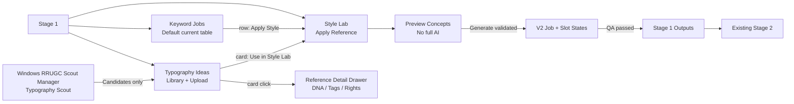

# Typography Engine V2 — UI/UX Blueprint & Frontend Handoff

> **Mục đích:** Đây là **đặc tả giao diện đích đủ để thi công**, đi cùng runbook kỹ thuật và checkpoint. Các quyết định UI trong tài liệu này là **mặc định triển khai khi người dùng chỉ gõ “tiếp tục”**; không cần hỏi lại cách bố trí cơ bản. Bản `UI_PREVIEW.html` là prototype *offline*, dùng dữ liệu giả, **không phải website CAM đang hoạt động**. Nút `Windows Tool mock ↗` ở góc trên chỉ chuyển sang màn hình **minh họa ứng dụng Windows riêng**, không phải một subtab Stage 1 hoặc tính năng web phải thêm.
>
> **Hiện trạng:** UI V2 chưa được code/deploy; toàn bộ route, component, endpoint trong mục “proposed” cần đối chiếu `origin/main` ở G0. Không được gọi prototype là tính năng production. Tất cả hình vẽ trong prototype là nội dung giả lập không đưa ảnh/tài khoản riêng tư vào GitHub.

## 0. Quyết định thiết kế đã chốt (Design lock V1)

1. Giữ **top Stepper Stage 0 → Stage 1 → Stage 2 → Stage 3** và navbar CAM hiện có. **Không thêm Stage 4, không thay toàn bộ Stage 1, không đổi cột số liệu keyword hiện có**.
2. Bên trong **Stage 1**, thêm sub-navigation nằm dưới header: **`Keyword Jobs` | `Typography Ideas` | `Style Lab`**. Mặc định vẫn vào `Keyword Jobs` để tương thích người dùng cũ.
3. `Typography Ideas` dùng một thư viện *trong CAM*, không đưa người dùng sang website riêng. Hỗ trợ batch upload, browse, filters, inspect DNA, manual approve.
4. `Style Lab` là nơi áp reference cho **một keyword được chọn**. Bố cục 3 vùng: **References** (trái) → **Concept Previews** (giữa) → **Balanced Controls & QA** (phải). Có drawer xem chi tiết nhưng không mở modal phủ toàn màn hình mặc định.
5. **Balanced** là mode duy nhất được hỗ trợ lúc ra mắt; **`Layout`, `Font`, `Overlap` mặc định bật**. Không đưa `Color`, `Brim pattern`, `Hat lighting`, `Product styling` vào bộ chuyển style Stage 1.
6. UI Windows Tool **thêm card `Typography Scout` vào RRUGC Scout Manager**, giữ toàn bộ card và nút `Run automation`, `Pause`, `Chrome minimize` hiện có. Card mới có điều khiển Pause/Resume độc lập. Không tạo app khác, không bắt máy Windows chạy ImageGen.
7. Không thao tác ghi bằng việc mở/click preview; **upload / approve / generate / save config** chỉ sau thao tác rõ ràng. Auto Scout **OFF** mặc định, không tự duyệt/đưa ảnh mới vào generation.
8. UI phải phản ánh đúng `queued/running/partial/completed/failed` theo **từng slot**, không tạo filler để đủ 6 ảnh. `concept-short-v1` vẫn có thể dùng như trước; `concept-short-v2` chỉ khả dụng sau khi feature flag + gate đạt.
9. Phân quyền theo tenant/workspace và navigation grants hiện có. Không ngầm cấp quyền upload, approve hoặc generation cho Viewer chỉ vì họ nhìn thấy Stage 1.
10. **Source of truth:** Khi implement, UI sử dụng component, font, icon, spacing token thực tế của CAM sau G0; nếu thiếu mới tạo scoped tokens trong Stage 1, **không sửa global CSS bừa bãi**.

## 1. Sơ đồ màn hình / luồng điều hướng



- Đường dẫn URL **đề xuất**, phải map vào router hiện hữu sau khi khảo sát: Stage 1 giữ route thực tế, dùng query `?stage=1&view=jobs|ideas|style-lab&keyword_job_id=<id>`, hoặc nested routes tương đương. Không tự ý tạo một public route không qua CAM auth.
- `Apply Style` mở trực tiếp `Style Lab` với keyword và selection context; back browser về bảng mà không mất search/sort/page. Reference Detail là drawer sâu, dùng back/close để giữ selection.
- `Typography Ideas` là workspace-scoped; tham chiếu `global/workspace/campaign/keyword/skill` được thể hiện dưới dạng scope chip, với quyền và thứ tự ưu tiên rõ ràng.

## 2. Stage 1 — Keyword Jobs (nâng cấp không phá UI đang có)

### 2.1 Wireframe desktop 1440px

```text
[Stage 0]────[Stage 1: Keyword Image Generation]────[Stage 2]────[Stage 3]
┌────────────────────────────────────────────────────────────────────────────────────────────────────┐
│ STAGE 1 / KEYWORD-TO-IMAGE       Generate images from used keywords                                │
│ [Keyword Jobs] [Typography Ideas (128)] [Style Lab]   [Search used keywords...] [Generate all] [...]│
├────────────────────────────────────────────────────────────────────────────────────────────────────┤
│ [294 All] [109 Not run] [2 Queued] [1 Running] [151 Completed] [31 Failed]  [V1 / V2 feature chip] │
├────────────────────────────────────────────────────────────────────────────────────────────────────┤
│ Keyword + Source | Trend | Search volume | Skill | Job Status | Duration | Finished | Output | Action│
│ BEACH BABE       | ▄▆▁   | 20            | V1    | Completed  | 06:25    | 08m      | [4...] | [...]│
│  [reference 2]   |       |               |       |            |          |          |        |[Apply]│
│ COOL UNCLE       | ▂▆▃   | 40            | V2    | Partial 4/6| 07:18    | 12m      | [4...] |[Apply]│
└────────────────────────────────────────────────────────────────────────────────────────────────────┘
```

### 2.2 Thay đổi cụ thể

- Bên dưới header hiện hữu thêm `Stage1Subnav` cao khoảng **40px**, cách khu vực KPI tối thiểu **12px**. Không dịch chuyển stepper Stage 0–3.
- Thêm **một nút rõ ràng `Typography Ideas`** (số reference được duyệt) và subtab `Style Lab`. `Keyword Jobs` vẫn active mặc định.
- Không thêm nhiều cột mới vào bảng vốn đang dày. **Trong cột `Actions` hiện có**, thêm icon/button nhỏ `Apply style` (tooltip + accessible label). Trong cell keyword, có thể hiện chip `Refs 2` **chỉ khi đã gắn reference**, không kéo giãn cell.
- Giữ search, sort, filters, `Generate all unused`, `Picked design` và các output thumbnails cũ. Khi feature flag OFF, `concept-short-v2` không tự xuất hiện trong dropdown skill; chỉ hiển thị entry `Typography Ideas` nếu quyền read được cấp.
- Khi V2 có output partial, hiện `Partial 4/6 · 2 need attention` với status + lý do; không gọi `Completed`, không insert placeholder/ảnh synthetic. V1 giữ contract cũ.
- Row click vào thumb output vẫn mở viewer/modal hiện hành; **không** thay đổi thumbnail size và cơ chế chọn thiết kế Stage 1 đang dùng.

## 3. Typography Ideas Library — Web

### 3.1 Wireframe desktop

```text
┌─────────────────────────────────────────────────────────────────────────────────────────────────────┐
│ [Keyword Jobs]  [Typography Ideas ●]  [Style Lab]                                     [Upload ideas]│
│ Typography Ideas Library                     128 approved · 12 need review · 8 analyzing           │
├─────────────────────────────────────────────────────────────────────────────────────────────────────┤
│ [Search style/tag/source...] [Style ▼] [Source ▼] [Scope ▼] [Status ▼] [Sort ▼]  [My uploads only]  │
├─────────────────────────────────────────────────────────────────────────────────────────────────────┤
│ [□ image]    [□ image]    [□ image]    [□ image]    [□ image]                                  ...   │
│ Interlocking  Vintage Arch  Script Serif   Editorial       Curved Varsity                            │
│ Ready · 🔵    Approved     Needs review    Ready          Approved                                   │
│ [Use style]   [Use style]   [Review]        [Use style]    [Use style]                                │
│                                                                                                     │
│ [Load more / Infinite scroll; preserve filters + selection]                                         │
└─────────────────────────────────────────────────────────────────────────────────────────────────────┘
```

### 3.2 Cấu trúc component

| Component | UI cụ thể | Data/behavior |
|---|---|---|
| `TypographyIdeasHeader` | H1, mô tả, 4 counters, nút `Upload ideas` | Approved / Analyzing / Needs review / Total theo API, không hardcode |
| `ReferenceFilterBar` | Search 260–340px, selects style/source/scope/status/sort | URL query giữ filter, paging; có Reset |
| `ReferenceMasonryGrid` | 4 cột >=1280, 3 cột 900–1279, 2 cột 600–899, 2 cột ở mobile nếu đủ rộng | Aspect ratio ảnh không ép bằng nhau; virtualize/lazy-load khi >100 |
| `ReferenceCard` | Ảnh lớn, state badge, title/tags tối đa 2 dòng, scope chip | Click mở drawer; `Use style` đi Style Lab; card không tự chạy AI |
| `BatchUploadPanel` | Dropzone, file list, remove/retry, upload progress mỗi file | Có xác nhận upload, max 20MB/file **theo validation backend**; batch default tối đa 20 file, 3 parallel upload; chỉnh sau đo |
| `ReferenceDetailDrawer` | Ảnh original, crop typography overlay, DNA tabs, tags/scope/notes/rights/status | `Reanalyze` có reason/idempotency, `Approve/Archive` chỉ có quyền |
| `BulkSelectionToolbar` | Selected n, tag, scope, archive/approve có xác nhận | Chỉ xuất hiện khi chọn >0, actions permission-guarded |

**Card trạng thái bắt buộc:** `Uploading` → `Analyzing` → `Needs review` / `Approved` / `Failed` / `Blocked rights` / `Archived`. Phải phân biệt `analysis_status` và `editorial_status` trong tooltip/detail; một reference **có DNA sẵn nhưng chưa approved** chưa đủ điều kiện tự động dùng trong generation.

### 3.3 Drawer / upload states

- Drawer desktop **560px** bên phải, overlay mờ, sticky top title + close, footer action sticky; viewport hẹp (<768) dùng full-screen sheet.
- Tab trong drawer: `Overview | Style DNA | Usage & Lineage` (không add side navigation phụ). `Style DNA` hiển thị **Layout Graph, Font Mood, Overlap Rules** + confidence và `Edit metadata` nếu có quyền; không coi ảnh tham khảo đã được license chỉ vì user upload.
- Upload modal desktop rộng 680px; file list hiển thị tên, KB/MB, progress, error reason; hỗ trợ `JPG/PNG/WEBP` và HEIC nếu backend đã verify; không quảng cáo HEIC nếu chưa hỗ trợ. Dropzone hỗ trợ click chọn file ngoài drag/drop.
- Upload lỗi 1 ảnh không hủy cả batch; duplicate => `Already in library` kèm link reference; cancel chỉ ảnh đang queued nếu backend không hỗ trợ abort. Không dùng alert browser để báo thành công.

## 4. Style Lab — Apply Reference to Keyword (màn hình ưu tiên)

### 4.1 Wireframe desktop 1440px

```text
┌─────────────────────────────────────────────────────────────────────────────────────────────────────┐
│ ← Back to Keyword Jobs | STYLE LAB                                    [Saved plan] [Generate]     │
│ Keyword: [BEACH BABE                        ]   [Change keyword ▾]  [V2] [Balanced]                 │
├───────────────────────────┬──────────────────────────────────────────────┬──────────────────────────┤
│ REFERENCES   (24%)        │ CONCEPT PREVIEWS   (fluid ~50%)             │ STYLE CONTROLS   (~26%)  │
│ [Search / filters]        │ [Preview concepts] [3 / 6 ready]           │ Mode: BALANCED (locked)  │
│ □ My ideas (priority)     │ ┌────────────┐ ┌────────────┐              │ [✓] Layout               │
│ ▣ Ref A / Ready          │ │ C1         │ │ C2         │              │ [✓] Font                 │
│ ▣ Ref B / Ready          │ │ BEACH BABE │ │ BEACH BABE │              │ [✓] Overlap              │
│ □ Ref C / Needs review   │ │ Arch Serif │ │ Script Mix │              │ Reference scope: Keyword │
│ [Auto match]             │ │ QA passed  │ │ QA passed  │              │ [Layout strength: medium]│
│ (why this reference?)    │ └────────────┘ └────────────┘              │ Text Lock: ON (required) │
│                           │ ┌────────────┐ ┌────────────┐              │ Originality: ON          │
│                           │ │ C3         │ │ C4         │              │ Embroidery QA: ON       │
│                           │ │ ...        │ │ rejected   │              │ [Preview low-cost]      │
│                           │ └────────────┘ └────────────┘              │ [Generate eligible]      │
│                           │  [Compare refs] [Details / QA]             │ Est. budget / job status │
└───────────────────────────┴──────────────────────────────────────────────┴──────────────────────────┘
```

### 4.2 Layout/behavior

- Desktop ≥1280: `References` **23–25%, min 270px**; `Concept Previews` **flex-grow, min 440px**; `Style Controls` **280–310px**; gaps 12px. Vùng resizable chỉ khi có persistence/QA; bản đầu tiên có thể fixed responsive grid để tránh rối.
- 769–1279: 2 cột `References` 32% + `Previews` 68%, Style Controls chuyển thành drawer/sheet `Controls`, với button cố định ở preview header.
- <=768: xếp theo thứ tự **Keyword → Reference selector (list cuộn, tóm tắt refs đã chọn) → Controls → Preview cards**; khi triển khai thực tế bổ sung sticky action CTA trong vùng controls. Không dùng lưới 3 cột bé xíu trên mobile.
- `Keyword exact` hiển thị dạng **read-only source** khi mở từ một keyword job; chỉ `Change keyword` chọn job khác, không chỉnh âm thầm quote để tạo biến thể. Khi standalone tạo plan, input ghi rõ “Exact text”, không trim/punctuate/reorder trong stored payload.
- `Mode: Balanced` không có dropdown `Inspiration/Strong` ở bản pilot. Tên hai mode kia có thể ghi trong tài liệu future nhưng **không render nút giả**.
- 3 checkboxes `Layout`, `Font`, `Overlap` tick mặc định; `Color/Brim/Lighting` không nằm trong component Stage 1. Có icon info giải thích. Khi bỏ overlap, composer bảo vệ reading order; không làm mất glyph.
- Sources: `My uploads > curated library > approved scout`. Manual refs tối đa 6 **chosen** trong pilot; AI matching lấy 2–4 Style DNA vào mỗi concept khi đủ điều kiện. Khi muốn chọn ref chưa approved, UI disable + tooltip `Needs approval / rights review`.
- Concept cards: tự do chiều cao nhưng card body đồng nhất; preview canvas **trong suốt/checkerboard** thay vì nền đen; thumbnail không phải ảnh mũ. Khi dùng actual imagegen output, giữ kích thước/crop như Stage 1 hiện có.
- Mỗi concept hiển thị `C1–C6`, layout family, primary style/ref, QA `Passed/Needs revision/Rejected`, chi phí ước tính khi được server cấp; `Retry this slot` **chỉ** dành cho slot failed/rejected, không rerun cả bộ.
- `Preview concepts` chạy renderer/low-cost preview; `Generate eligible` là action có tác động chi phí, có confirm modal nêu estimated output count, không tự generate do selection change; chỉ gửi eligible slots theo contract G5.
- `Picked Design` **chỉ xuất hiện trên actual finalized Stage 1 outputs**; không pick một mock preview khi chưa được ImageGen/QA phát hành. Không đổi Stage 2.

### 4.3 Precedence & badges

Thứ tự effective reference: **Keyword override > Campaign > Skill preset > Workspace Library**; user-selected refs được đánh dấu rõ `Manual`, `Inherited`, `Auto matched`. `Disable inherited` chỉ áp dụng scope hiện tại, không xóa reference global. Header hiển thị `Refs 2 manual + 3 auto` để minh bạch nguồn.

`V2` có các state: `Not enabled`, `Ready`, `Previewing`, `Preview ready`, `Generating`, `Partial x/y`, `Completed`, `Failed`, `Blocked by QA`. Trạng thái V2 tách với V1; link plan phải lưu `keyword_job_id`, `source_keyword_exact`, `DNA versions`, `seed/trace`.

## 5. RRUGC Scout Manager — Windows Tool

### 5.1 Wireframe giữ phong cách tool hiện có

```text
RRUGC Scout Manager   vNext     [Run automation] [Pause] [Chrome minimize toggle]
Agent-Reach · VPS Auto Discover  [Connected/Waiting] [last heartbeat]
┌──────────────────┬───────────────────┬──────────────────┐
│ Review Scout     │ Keyword Scout     │ Cap Stack Scout  │
│ Running          │ Running           │ Running          │
└──────────────────┴───────────────────┴──────────────────┘
┌─────────────────────────────────────────────────────────┐
│ Typography Scout           [OFF by default] [Enable*]  │
│ Discover candidates • Source rights • Sync to CAM      │
│ Candidates  40  │ Needs review  12 │ Synced  28        │
│ Last sync • Active lease • Outbox pending • Next retry │
│ [Pause] [Resume] [View diagnostics] [Open CAM Library] │
└─────────────────────────────────────────────────────────┘
Branding DNA / Browser Agent (unchanged)
```

`* Enable` chỉ hiển thị có thể bấm khi `TYPOGRAPHY_SCOUT_ENABLED` và source rights/pairing gate đã đạt; không tự bật trên cài đặt mới. Giữ vị trí và hành vi **global Run / Pause** và toggle minimize Chrome ở cạnh Pause; minimize chỉ thu nhỏ cửa sổ, **không kill browser processes hoặc stop task**.

### 5.2 Components & diagnostics

- `TypographyScoutCard`: source profile, service `Waiting/Running/Paused/Blocked/Offline/Error`, nút `Pause/Resume` scoped riêng, đếm `candidates`, `review`, `synced`, `duplicate`, `rejected`, `pending outbox`.
- Click `Details & diagnostics` mở accordion có bảng task `source`, `lease id` đã rút gọn, `started`, `last heartbeat`, `retry reason`, `rate-limit`, `source rights status`. Secret/token/profile path không hiện plaintext.
- Khi Windows mất mạng: `Offline — discovery paused; pending outbox n`, không chuyển các candidate chưa đồng bộ thành `Synced`. Khi paired token bị revoke: `Blocked — re-pair required`, không loop retry vô hạn.
- Khi Chrome minimized: card hiển thị `Chrome minimized · scouting continues` nếu thật sự còn lease/heartbeat; nếu Chrome bị tắt, báo `Browser not running`, không khẳng định tiếp tục.
- Thiết lập source, rate limit, lịch chạy, Chrome profile riêng tại `Settings` nhỏ trong accordion; mặc định chỉ hiện các source đã được cấp phép và bật trong allowlist, không hiển thị scrape API trái phép.
- Tauri desktop window min width đề xuất 900px, desktop card grid 3 cột với card mới nằm hàng tiếp theo; <=1100px 2 cột; <=700px 1 cột và horizontal scroll actions trong card. Không thay đổi Branding DNA card.

## 6. Design system: token, kích thước, component rules

> Giá trị dưới đây là **UI blueprint tokens** chứ không khẳng định đang có trong source. G0 đối chiếu tokens hiện tại; ưu tiên dùng lại theme CAM, chỉ override scoped nếu cần. Đảm bảo cùng dark/light theming nếu app đã hỗ trợ.

| Token/element | Giá trị đề xuất | Ghi chú |
|---|---|---|
| `--typo-accent` | `#315DE5` | Xanh CAM, chỉ dùng cho action active/focus |
| `--typo-bg` | `#F6F8FC` | Page bg; giữ màu theme hiện hành nếu đã có |
| `--typo-surface` | `#FFFFFF` | Card/background |
| `--typo-border` | `#DFE5F0` | 1px viền trung tính |
| `--typo-text` | `#17243D` | Text chính |
| `--typo-muted` | `#66738A` | Text phụ, không dùng quá nhạt cho thông tin quan trọng |
| Status | `#1A7755` pass, `#A45A13` warning, `#B42318` error | Cần icon/text đi kèm, không dùng chỉ màu |
| Radius | 8px input, 10–12px cards, 14px drawers | Đúng hierarchy |
| Spacing | 4/8/12/16/24px | Gaps đồng nhất, không nhiều card lồng card |
| Text | H1 20–24px; section 15–16px; body 13–14px; meta 12px | Không xuống dưới 12px cho UI chính |
| Button/input | Cao 36–40px desktop; touch target ≥44px mobile | Focus-visible rõ |
| Main container | Fluid, min 16px sides desktop / 12px mobile | Không full-screen scroll ngang do panel |
| Top Stage 1 subnav | 40px, sticky chỉ nếu hiện Stage 1 sticky header | Không trùm drawer của CAM |
| Library thumbnail | Width 100%; aspect natural; min visible 148px | `object-fit:contain` cho reference design, không crop mất chữ |
| Reference drawer | Width 560px desktop; full width mobile | `z-index` cao hơn responsive navbar, chặn scroll nền |
| Style Lab controls | Width 280–310px desktop | Drawer ở tablet/mobile |
| Concept preview | 2 cols desktop; 1 col mobile | Checkerboard alpha, no black bg |

**Accessibility:** focus ring, nút có accessible name, tooltip không phải cách duy nhất cung cấp thông tin, controls có label/aria, escape closes drawer, keyboard navigation/breadcrumbs, disabled reason, alt text, labels cho percentages/progress, tối thiểu WCAG AA contrast theo thực tế theme. Drawer/modal tuân thủ focus trap + restore focus, body scroll lock, z-index được test ở tablet 768px (bài học từ Access Management).

## 7. Screen state matrix — không bỏ trống

| View / state | Thiết kế phản hồi UI | CTA hợp lệ |
|---|---|---|
| Library empty | Illustration placeholder + `Upload your first ideas` + rights note | Upload (nếu được cấp quyền) |
| Library loading | Skeleton 6–10 cards + filter disabled vừa đủ | Không kích hoạt generate |
| Upload multi-file partial | Mỗi ảnh có progress/result; summary `7 uploaded · 1 duplicate · 2 failed` | Retry failed only |
| Uploaded, analysis pending | `Queued for analysis` + khả năng xem original | Không `Use style` cho Auto Gen nếu DNA chưa có |
| DNA ready but needs review | `Needs review` với CTA `Review reference` | Approve nếu manage permission |
| No text in photo | `Analysis needs attention` + crop/manual adjust | Re-analyze/Manual mark |
| Blocked source rights | Status `Blocked` + nguồn/lý do, thumbnail nếu được phép | Không Approve/Generate khi bị chặn |
| Scout offline | Hiện last heartbeat/outbox pending | Pause/Retry connection theo quyền |
| Keyword no applicable refs | `No approved references match`; link Library | Upload/Choose/Auto match when available |
| V2 disabled | `Try V2` bị disabled, tooltip rollout flag | V1 vẫn chạy |
| Preview running | Progress từng C slot, cancel only if supported | Không duplicate submit |
| Preview partial (4/6) | 4 cards eligible + 2 failed reason | Generate 4 eligible / retry 2 failed |
| Generation partial | Không tạo filler; giữ output hoàn tất | Retry failed slot / inspect QA |
| Exact text failure | Slot rejected, chữ lỗi highlight dạng text diff nếu được phép | Retry slot, không Picked |
| Error API/timeout | Inline error + correlation id rút gọn | Retry có giới hạn |
| Missing permission | Read-only hoặc button disabled có reason | Không lộ private images; không tự cấp quyền |
| Dark mode | Dùng token theme, không hard-coded black preview | Mọi state rõ tương phản |

## 8. Interaction contracts — click → API → result

| Người dùng làm gì | Bước UI | API tương ứng (đề xuất RUNBOOK §4) | Kiểm chứng |
|---|---|---|---|
| Mở Typography Ideas | `Stage1Subnav`, persist tab | `GET /typography/references` | read-only, tenant scoped |
| Upload batch | Drag/drop → validate → confirm | `POST /typography/references/uploads` | status per file, dedup, no auto approve |
| Edit metadata/rights | Drawer → edit → save | `PATCH /typography/references/{id}` | role manage, audit, source rights preserved |
| Approve reference | Detail → approve + reason | `PATCH .../{id}` | quyền và nguồn hợp lệ, audit |
| Reanalyze crop | Detail → crop → reanalyze | `POST .../{id}/analyze` | versioned DNA, bounded retry |
| Select reference | click checkbox/card; local preview | **Không gọi mutation API** trừ lưu plan khi user chủ động | selection local until save |
| Auto match | click Auto match | `POST /typography/match` | show sources, score/reason; no auto generation |
| Preview concepts | click `Preview concepts` | `POST /typography/previews` | no full ImageGen; QA per slot |
| Generate eligible | confirm output count → submit | `POST /typography/jobs` | idempotency, scope, quota, cost budget |
| Retry slot | click retry failed slot | job retry endpoint (validate actual contract G6) | không ghi đè completed, no mass rerun |
| Picked design | click finished output Picked | existing Stage 1 pick endpoint + feedback hook | Stage 2 same artifact |
| Windows Scout Start | click enable/run with permission | paired control API + lease | off by default, source checks |
| Windows Chrome minimize | toggle near global Pause | local window control | agent/task unaffected, verified |

**Error copy:** cụ thể, không dùng thông báo chung `Request failed.` nếu server có mã/triage. Mọi save/approve/generate có loading, success, failure và rollback optimistic state; không bao giờ hiển thị `Synced/Approved/Completed` trước khi backend xác nhận.

## 9. QA screenshot matrix và test IDs

Sau G0 xác nhận UI selectors thực tế, cố định **data-testid scoped** (không phụ thuộc text tooltip động) để Browser QA đáng tin cậy.

| ID | Viewport | Scene | Điều kiện Pass |
|---|---|---|---|
| `UX-01` | Desktop 1440×900 | Keyword Jobs + V1 rows | không mất KPIs/search/actions; no accidental rerun |
| `UX-02` | Desktop 1440×900 | Library grid populated | 4 cards/row phù hợp; thumbnails không bị crop chữ |
| `UX-03` | Tablet 768×1024 | Library + upload drawer | không bị navbar che close; no horizontal body overflow |
| `UX-04` | Mobile 390×844 | Library 2 cols / filter sheet | touch targets ≥44, search/filter usable |
| `UX-05` | Desktop 1440×900 | Style Lab 3 zones | all layout/font/overlap checked, Balanced visible |
| `UX-06` | Tablet 768×1024 | Style Lab controls sheet | preview visible, no hidden actions |
| `UX-07` | Mobile 390×844 | Style Lab one-col + sticky action | exact keyword visible, no clipped CTA |
| `UX-08` | Desktop+Mobile | Reference details DNA & rights | role controls, approve disabled when blocked |
| `UX-09` | Desktop+Mobile | Partial 4/6 | no fake slots, generate only valid 4 |
| `UX-10` | Desktop+Mobile | Job progress error/retry | no duplicate submit, no output overwrite |
| `UX-11` | Windows 1064×768 | Scout Manager existing + Typo card | old controls intact, new module independent |
| `UX-12` | Windows 900×720 | Chrome minimize + heartbeat | background tasks continue, not interpreted as Pause |
| `UX-13` | All | Keyboard focus + modal close | Esc closes, focus restored, trap works |
| `UX-14` | All | Viewer/Editor/admin tenant permissions | read-only/403 secured, no leaked references |
| `UX-15` | All | Reference ineligible + no matching DNA | disable Generate, show reason/action |
| `UX-16` | All | `concept-short-v1` selected | existing UI and outputs unchanged |

**Screenshot naming convention:** `ui-v2-<id>-<viewport>-<state>.png`; store only sanitized demo data or explicitly approved QA evidence in PR. Do not put production tokens, real users or private references in public PR.

### 9.1 Ảnh chuẩn giao diện được dựng từ prototype (mock only)

Bản handoff có các screenshot **dữ liệu giả đã được tạo từ HTML**, để developer đối chiếu bố cục và CI/Browser QA làm visual regression khi implement. **Ảnh này không chứng minh CAM production đã có tính năng.**

| Màn hình đích | Ảnh chuẩn trong gói |
|---|---|
| Stage 1 Keyword Jobs — Desktop | [`prototypes/screenshots/ui_stage1_jobs_desktop.png`](prototypes/screenshots/ui_stage1_jobs_desktop.png) |
| Typography Ideas Library — Desktop | [`prototypes/screenshots/ui_ideas_desktop.png`](prototypes/screenshots/ui_ideas_desktop.png) |
| Style Lab Balanced — Desktop | [`prototypes/screenshots/ui_lab_desktop.png`](prototypes/screenshots/ui_lab_desktop.png) |
| Style Lab Balanced — Mobile | [`prototypes/screenshots/ui_lab_mobile.png`](prototypes/screenshots/ui_lab_mobile.png) |
| Windows Scout Manager — Tool UI | [`prototypes/screenshots/ui_windows_desktop.png`](prototypes/screenshots/ui_windows_desktop.png) |

Các screenshot khác cho tablet/mobile được tạo lại từ HTML khi G2/G4/G7 bắt đầu. Không lưu ảnh reference thật hoặc metadata tài khoản trong screenshot đem push lên PR công khai.

## 10. Component / source implementation map (proposed)

| Gate | Component/service | Gợi ý vị trí (xác minh ở G0) |
|---|---|---|
| G2 | `Stage1Subnav`, `TypographyIdeasPage`, `ReferenceCard`, `ReferenceUploadDialog`, `ReferenceDetailDrawer` | `apps/client/app/realistic-review-ugc/.../typography/` hoặc submodule phù hợp layout hiện tại |
| G2 | `useTypographyReferences`, types, API client, optimistic UX | `apps/client/features/typography/` |
| G4 | `StyleLabPage`, `ReferenceSelector`, `StyleControls`, `ConceptPreviewGrid`, `QAResultCard` | route/subview Stage 1; preserve keyword table state |
| G5 | `PartialSlotsSummary`, exact-text warning, retry actions | match existing job model/DB contract; no V1 broad changes |
| G6 | `V2SkillChip`, `ReferenceCount`, `ApplyStyleAction` | integrate existing Stage 1 actions cell |
| G7 | `TypographyScoutCard`, scoped diagnostics and settings | `apps/scout-manager-desktop/src/` Tauri app hiện có |
| G8 | `data-testid` QA fixtures, story fixtures, screenshot scripts | existing Vitest/Browser QA structure |

**Shared components:** reuse `Button`, `Input`, `Dialog`, `Badge`, `Tooltip`, `Tabs`, `Masonry`, `StatusIndicator` của CAM nếu tồn tại; nếu thiếu thì tạo component scoped. CSS nên dùng class prefix `typography-` hoặc CSS module, không override `.card`, `.btn`, `.modal` global.

## 11. Acceptance không thể bỏ qua trước khi code tiếp

- [ ] UI Blueprint này và prototype HTML được lưu trong `main` cùng runbook và state theo G0.0.
- [ ] `Keyword Jobs` V1 không bị đổi workflow, stepper, filters và output pick.
- [ ] Typography Ideas có batch upload, review/rights, thumbnail, search/filter, DNA detail, archive và trạng thái lỗi.
- [ ] Style Lab có ba controls Layout/Font/Overlap, Balanced rõ ràng, source keyword exact; preview là non-destructive; generate cần confirm.
- [ ] Windows Typography Scout giữ nguyên global controls, trạng thái minimize và không chạy khi feature flag OFF.
- [ ] Responsive desktop/tablet/mobile và z-index sheets không che controls; UX-01..UX-16 đạt.
- [ ] 3–6 concept có partial rõ, không lấp giả sáu output; QA exact text đọc được ở UI.
- [ ] Không thêm dữ liệu reference riêng tư hay secret vào public repository khi commit blueprint/prototype.
- [ ] QA có screenshot trước/sau và bản prototype là design reference cho code review; khác biệt có chủ đích phải được ghi lại trong state.

## 12. Quy tắc cho lệnh “tiếp tục”

1. Đọc RUNBOOK → STATE → **UI_BLUEPRINT này** trước mọi thay đổi UI. Prototype là mẫu thị giác, không có authority về API/production.
2. Triển khai UI theo đúng routes/components/states ở §1–§10, không tự thiết kế lại giao diện theo ý tác vụ. Nếu code hiện tại khác, ưu tiên giữ tương thích và ghi rõ khác biệt hợp lý trong PR/state.
3. Sau mỗi gate UI (G2, G4, G6, G7, G8), đối chiếu **UX-01..UX-16**; chụp screenshots và sửa layout nếu sai trước khi gate VERIFIED.
4. Chỉ phát hành source từ `main`, CI all green; rollback giữ current/previous của backend, frontend và Windows Tool.
5. Gặp blocker về quyền hoặc API: ghi state `BLOCKED`, không bypass hard-block, không tự sửa quyền shop/tenant và không tự xoá data.

**File chuẩn đi cùng:** `CAM_TYPOGRAPHY_ENGINE_V2_RUNBOOK.md`, `CAM_TYPOGRAPHY_ENGINE_V2_STATE.md`, `CAM_TYPOGRAPHY_ENGINE_V2_UI_PREVIEW.html`. **Owner:** CAM project. **Thiết kế đích v1**, có thể bắt đầu thi công theo blueprint này khi người dùng nói “tiếp tục”.
